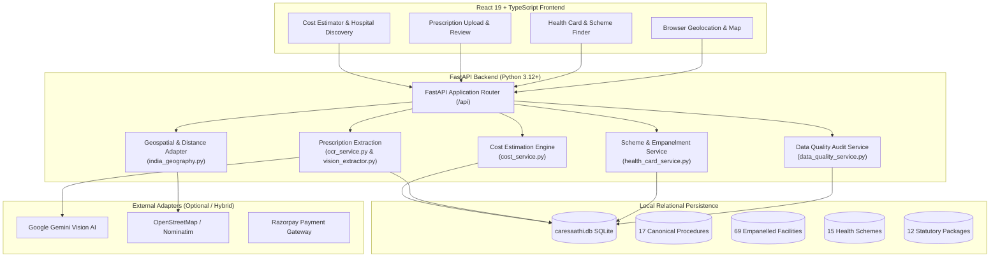

# CareSaathi AI (केयरसाथీ / కేర్ సాథీ)

> **Out-of-Pocket Healthcare Expenditure Prediction & Reduction Platform for India**  
> *Know the Cost. Find the Care. Discover the Support.*

[](LICENSE)
[](https://www.python.org/)
[](https://fastapi.tiangolo.com/)
[](https://react.dev/)
[](https://www.typescriptlang.org/)
[](https://vitejs.dev/)
[](https://www.sqlite.org/)
[](tests/)

---

## 📌 Overview & Motivation

In India, out-of-pocket expenditure (OOPE) accounts for over **50–60% of total healthcare spending**, driving millions of families into catastrophic financial distress each year. Patients and caregivers frequently face severe information asymmetry:
1. **Unpredictable procedure costs** across government, charitable, and private hospital tiers.
2. **Complex public scheme eligibility**, where patients do not know whether a specific surgery or test is covered under **Ayushman Bharat PM-JAY** or state schemes like **Telangana Rajiv Aarogyasri**.
3. **Inflated medicine expenses**, lacking awareness of statutory generic alternatives available via **Jan Aushadhi Kendras**.

**CareSaathi AI** is a full-stack, deterministic healthcare cost estimation, hospital navigation, and scheme discovery platform engineered to address:

> **Problem Statement 2: Out-of-Pocket Healthcare Expenditure Prediction and Reduction**

The platform helps patients estimate probable treatment and diagnostic expenses, discover appropriate nearby facilities, identify applicable statutory health schemes and insurance packages, analyze prescription medications, and make informed financial decisions before hospital admission.

---

## 🏗️ System Architecture & Data Flow



---

## 🌟 Key Features & Implemented Capabilities

### 1. Deterministic Cost Estimation for Surgeries & Diagnostics
- Covers all **17 canonical medical treatments and diagnostics**:
  - **Diagnostics & Imaging:** MRI Brain, MRI Knee, MRI Lumbo-Sacral Spine.
  - **Diagnostics & Pathology:** Comprehensive Diagnostic Blood Profile (CBC, LFT, KFT, Lipid, TSH).
  - **Renal Replacement:** Maintenance Hemodialysis (Per session).
  - **Outpatient & Chronic Care:** Super-Specialist OPD Doctor Consultation, Comprehensive Diabetes Care.
  - **Surgical & Maternity:** Total Knee Replacement (TKR), Cataract Surgery (Phaco + Foldable IOL), Normal Delivery, Caesarean Section (LSCS), Coronary Angioplasty (PTCA + DES), Laparoscopic Cholecystectomy, Appendectomy, Inguinal Hernia Repair, Acute Febrile Illness / Dengue Inpatient Care, Kidney Stone Laser Removal.
- **Accurate Clinical Itemization:** Segregates diagnostic imaging expenses (magnet time, radiologist interpretation, PACS/films) and pathology workflows (automated analyzers, phlebotomy vacutainers) from surgical operating theatre (OT) tariffs and implants.
- **Zero Hallucinated Prices:** When an unsupported treatment is queried, returns a clean, transparent 404 unavailable state rather than fabricating prices.

### 2. Precision Geolocation & Facility Discovery (Suburban GPS Fix)
- Live browser geolocation and reverse geocoding without hardcoded fallback PINs (e.g. suburban **Nizampet, Hyderabad** accurately resolves to **Medchal–Malkajgiri / PIN 500090** rather than generic GPO 500001).
- Haversine and road network distance calculations preserved across all queries.
- UI labels guarded against `undefined` or `null` artifacts.

### 3. Scheme & Insurance Navigation
- Integrated scheme catalogue covering:
  - **Ayushman Bharat PM-JAY** (National Health Authority, ₹5 Lakh coverage).
  - **Telangana Rajiv Aarogyasri** (State Health Care Trust, ₹10 Lakh coverage).
  - **Employees' Health Scheme (EHS)** and **Central Government Health Scheme (CGHS)**.
  - **Employees' State Insurance (ESIC)** and **Private Insurance TPAs**.
- Procedure-specific verification status distinguishes `verified_procedure` from `needs_confirmation`.
- Statutory package codes mapped directly to treatments (e.g. PM-JAY `SU03001A`, Aarogyasri `S4.1.1`).
- Administrative empanelment updates protected with **Bearer JWT authentication** (unauthenticated requests rejected with 401).

### 4. Prescription OCR & Medicine Cost Reduction
- Multimodal **Gemini Vision** (`gemini-2.5-flash`, `gemini-1.5-flash`) with resilient local fallback for offline/test environments.
- **Noise Rejection:** Rejects list numbers (`1.`, `2`, `3)`) as medicine names.
- **Deduplication:** Merges repeat extractions of identical drugs (e.g. `Dolo 650`).
- **Generic Substitution:** Compares branded medications against statutory ceiling prices from the **National Pharmaceutical Pricing Authority (NPPA)** and generic equivalents from the **Pradhan Mantri Bhartiya Janaushadhi Pariyojana (PMBJP)**.

### 5. Patient Out-of-Pocket Comparison Workflow
- Directly accessible via the **Cost Estimator** page.
- Side-by-side comparison of suitable nearby facilities for the selected procedure.
- Explicit visual distinction between:
  - **Known Statutory Benefits:** Pre-authorized cashless package amounts.
  - **Estimated Out-of-Pocket Costs:** Standard room rent, copays, or consumable gaps.
  - **Potential Uncovered Expenses:** Premium implants exceeding statutory caps, deluxe room differentials, take-home medicines.
- Patient next-step guidance directing families to the hospital Aarogyamitra / Insurance TPA helpdesk.

### 6. Transparent & Explainable Recommendations
- Hospital cards display an explicit **"Why recommended"** badge based on:
  - Treatment/department clinical specialty match.
  - Physical distance from patient GPS coordinates.
  - Verified scheme empanelment status.
  - Transparent pricing confidence without fabricated reviews or artificial rankings.

### 7. Administrative Data Quality Audit Report
- Dedicated endpoint at `GET /api/admin/data-quality-report`.
- Audits active SQLite database records: file size, GPS coverage (69/69 facilities), statutory packages (12/12 with official codes), verified empanelments (26/28), and zero out-of-bounds coordinates.

---

## 💻 Technology Stack

| Layer | Technology | Purpose |
|---|---|---|
| **Frontend Framework** | React 19 (TypeScript) | User interface, state management, accessibility |
| **Bundler & Tooling** | Vite 8.3, Bun / Node.js | Fast development server and optimized client builds |
| **Styling & Animation** | Vanilla CSS + Framer Motion | High-performance design system, fluid transitions |
| **Iconography** | Lucide React | Consistent, accessible clinical iconography |
| **Backend Framework** | FastAPI (Python 3.12+) | Async REST API, Pydantic v2 validation, OpenAPI docs |
| **Database** | SQLite 3 (`caresaathi.db`) | Relational persistence, deterministic file path resolution |
| **Authentication** | PyJWT + Passlib (PBKDF2-HMAC) | Token-based session management, role verification |
| **AI / Multimodal Vision**| Google GenAI SDK | Handwritten and printed prescription extraction |
| **Geospatial Adapter** | OpenStreetMap / Nominatim | Reverse geocoding and coordinates resolution |
| **Testing** | Python `unittest` + FastAPI TestClient | Comprehensive backend regression test suite |

---

## 📁 Repository Structure

```
CareSaathi-AI/
├── .env.example                     # Environment template with sanitized placeholders
├── .gitignore                       # Git exclusion rules for secrets, DB, and builds
├── README.md                        # Master project documentation
├── caresaathi.db                    # Active SQLite relational database (290KB)
├── backend/                         # FastAPI Python backend
│   ├── app/
│   │   ├── main.py                  # API endpoints, middleware, static mount
│   │   ├── config.py                # Pydantic Settings and security validation
│   │   ├── data/
│   │   │   ├── database.py          # SQLite connection and additive migrations
│   │   │   ├── catalogue.py         # 17 canonical medical procedures
│   │   │   ├── health_card_data.py  # Scheme packages and hospital empanelments
│   │   │   ├── india_geography.py   # Reverse geocoding and location resolver
│   │   │   └── medicine_data.py     # NPPA & Jan Aushadhi medicine master
│   │   ├── models/
│   │   │   └── schemas.py           # Pydantic DTO request/response schemas
│   │   └── services/
│   │       ├── cost_service.py      # Procedure & diagnostic cost engine
│   │       ├── facility_service.py  # Hospital search and distance calculation
│   │       ├── health_card_service.py # Scheme & empanelment evaluation
│   │       ├── ocr_service.py       # Prescription extraction & deduplication
│   │       ├── vision_extractor.py  # Gemini Multimodal Vision integration
│   │       ├── data_quality_service.py # Database audit and provenance report
│   │       ├── auth_service.py      # User authentication and JWT management
│   │       ├── otp_service.py       # Server-side OTP verification
│   │       └── payment_service.py   # Razorpay verification and demo modes
│   └── requirements.txt             # Python backend dependencies
├── frontend/                        # React 19 + TypeScript Vite application
│   ├── src/
│   │   ├── App.tsx                  # Root app component and layout
│   │   ├── pages/
│   │   │   ├── CostEstimatorPage.tsx    # Procedure estimation & facility comparison
│   │   │   ├── HealthCardFinderPage.tsx # Scheme empanelment discovery
│   │   │   ├── HospitalDiscoveryPage.tsx# Map & nearby facility discovery
│   │   │   ├── DashboardPage.tsx        # Overview dashboard and quick search
│   │   │   └── LandingPage.tsx          # Educational landing page
│   │   ├── components/              # Modular UI components (modals, cards, charts)
│   │   ├── context/                 # Language, Search, and Auth state contexts
│   │   ├── services/
│   │   │   └── api.ts               # Typed frontend HTTP client
│   │   └── index.css                # Core design system and tokens
│   ├── package.json                 # Node dependencies and build scripts
│   └── vite.config.ts               # Vite configuration
└── tests/                           # Automated Python test suites
    ├── test_problem_statement_2_acceptance.py # Acceptance tests for PS2
    ├── test_health_card_finder.py   # Scheme and empanelment tests
    ├── test_gps_and_ocr_regression.py # GPS and prescription deduplication tests
    └── test_audit_remediation.py    # Security, auth, and database resilience tests
```

---

## ⚙️ Prerequisites & Installation

### Prerequisites
- **Python**: Version 3.10, 3.11, or 3.12 installed.
- **Node.js**: Version 18+ or **Bun** installed.
- **Git**: Installed and configured.
- **OS**: Windows, macOS, or Linux (Windows PowerShell instructions provided below).

---

## 🚀 Setup & Execution Instructions (Windows PowerShell)

### 1. Clone the Repository
```powershell
git clone https://github.com/Manisai-dms/caresaathiai.git
cd caresaathiai
```

### 2. Configure Environment Variables
Copy `.env.example` to create `.env` in the project root:
```powershell
Copy-Item .env.example .env
Copy-Item .env.example backend/.env
```
Open `.env` and fill in any optional credentials:
- `GEMINI_API_KEY`: Set your Gemini API key for live multimodal vision extraction (falls back gracefully to offline regex if omitted).
- `JWT_SECRET`: Random 32+ character string for token generation in production.

### 3. Backend Setup & Run (FastAPI)
In a Windows PowerShell terminal:
```powershell
cd backend

# Create a virtual environment
python -m venv .venv

# Activate the virtual environment
.\.venv\Scripts\Activate.ps1

# Install backend dependencies
pip install -r requirements.txt

# Start the FastAPI server on port 8000
python -m uvicorn app.main:app --host 127.0.0.1 --port 8000 --reload
```
The backend API is now running at `http://127.0.0.1:8000`.  
Interactive Swagger API documentation is available at `http://127.0.0.1:8000/docs`.

### 4. Frontend Setup & Run (React + Vite)
In a second PowerShell terminal:
```powershell
cd frontend

# Install frontend dependencies (using bun or npm)
bun install
# or: npm install

# Start the development server
bun run dev
# or: npm run dev
```
Open your browser at `http://localhost:5173`.

---

## 🗄️ Database Initialization & Data Provenance

The application connects to `caresaathi.db` located at the project root. On application startup, the `lifespan` handler calls `init_db()`, which:
1. Validates table existence (`treatments`, `facilities`, `schemes`, `health_card_packages`, `hospital_scheme_empanelments`, `cost_observations`, etc.).
2. Executes non-destructive, additive migrations (`PRAGMA table_info` checks).
3. Populates baseline reference data if empty.

### Verified Official Data Sources
- **National Health Authority (NHA)**: Ayushman Bharat PM-JAY Health Benefit Package (HBP 2.2) master codes.
- **Aarogyasri Health Care Trust (Telangana)**: Empanelled hospital list, helpdesk locations, and package codes.
- **Nizam's Institute of Medical Sciences (NIMS)**: Official published public hospital tariff card for diagnostics and surgeries.
- **National Pharmaceutical Pricing Authority (NPPA)**: Statutory ceiling price orders for orthopedic implants and coronary stents.
- **OpenStreetMap & Overpass Network**: Geospatial facility coordinates and locality mapping.

---

## 📡 API Reference & Core Endpoints

| Method | Endpoint | Description |
|---|---|---|
| `POST` | `/api/estimate` | Compute itemized procedure/diagnostic cost estimates and nearby facility comparisons |
| `GET` | `/api/facilities` | List or filter healthcare facilities by city, ownership, or specialty |
| `POST` | `/api/health-cards/search` | Search hospitals by health card/scheme, procedure, and GPS radius |
| `GET` | `/api/health-cards/hospital/{id}` | Retrieve comprehensive hospital scheme empanelment profile |
| `POST` | `/api/health-cards/admin/empanelment` | Authenticated administrative update of hospital empanelment status (Requires Bearer JWT) |
| `POST` | `/api/ocr/prescription` | Extract medicines and diagnostic procedures from prescription image |
| `GET` | `/api/medicines/search` | Search Jan Aushadhi generic equivalents and NPPA ceiling prices |
| `GET` | `/api/admin/data-quality-report` | Comprehensive data quality audit report (facility counts, GPS coverage, empanelments) |
| `POST` | `/api/auth/register` | Register new patient account |
| `POST` | `/api/auth/login` | Login and receive Bearer JWT access token |
| `GET` | `/api/metadata` | Application version, trust dashboard metrics, and data freshness dates |

---

## 🧪 Testing & Quality Assurance

### Run Backend Automated Tests
All 75 automated test cases across 10 test suites execute via Python `unittest`:
```powershell
.\backend\.venv\Scripts\python.exe -m unittest discover tests
```
**Test Results:**
```
Ran 75 tests in 1.790s
OK (All 75 tests passing, 0 failures)
```

Key test coverage includes:
- [tests/test_problem_statement_2_acceptance.py](file:///c:/Users/kaila/Downloads/CareSaathi-AI/CareSaathi-AI/tests/test_problem_statement_2_acceptance.py): Diagnostic cost breakdowns (MRI, Blood tests, Hemodialysis), surgery ranges, Nizampet GPS reverse geocoding, prescription deduplication, and 401 unauthenticated security rejection.
- [tests/test_health_card_finder.py](file:///c:/Users/kaila/Downloads/CareSaathi-AI/CareSaathi-AI/tests/test_health_card_finder.py): Multi-scheme search, procedure package verification, and empanelment filters.
- [tests/test_gps_and_ocr_regression.py](file:///c:/Users/kaila/Downloads/CareSaathi-AI/CareSaathi-AI/tests/test_gps_and_ocr_regression.py): Haversine distance accuracy, suburban coordinate handling, and OCR noise filtering.
- [tests/test_audit_remediation.py](file:///c:/Users/kaila/Downloads/CareSaathi-AI/CareSaathi-AI/tests/test_audit_remediation.py): Password hashing, CORS configuration, and database path determinism.

### Build Frontend Production Bundle
Validate TypeScript compilation and bundle creation:
```powershell
cd frontend
bun run build
# or: npm run build
```
**Build Output:**
```
✓ 2448 modules transformed.
✓ built in 945ms (0 errors)
```

---

## ⚖️ Cost Estimation Methodology & Responsible-Use Principles

1. **Informational & Non-Binding:** All calculated estimates represent indicative ranges based on published statutory package rates and empanelled hospital reference tariffs. They do **not** constitute a formal quotation or guaranteed billing contract.
2. **Clinical Variability:** Actual hospital charges vary based on surgeon seniority, room category (General vs Twin Sharing vs Deluxe), specific implant manufacturer, duration of stay, and unforeseen clinical complications.
3. **Pre-Admission Pre-Authorization:** Patients eligible for PM-JAY or Aarogyasri must obtain pre-authorization from the hospital **Aarogyamitra** desk before undergoing elective procedures.
4. **Non-Diagnostic:** CareSaathi AI is an educational financial navigator and does not provide clinical diagnoses, triage acute medical crises, or replace consultation with a qualified medical practitioner.
5. **Emergency Red-Flag Interruption:** When acute life-threatening symptoms (severe chest pain, stroke signs, severe hemorrhage) are detected, the system immediately presents an emergency alert directing the patient to dial the **National Ambulance Service (108)**.

---

## 🔒 Security & Privacy Guarantees

- **Zero Clinical Image / PII Retention:** Raw prescription images and extracted patient clinical histories are processed in-memory and are **never permanently stored** on the server.
- **Cryptographic Security:** Passwords hashed with PBKDF2-HMAC with unique salt. Session authentication enforced via signed Bearer JWTs.
- **Administrative Protection:** Public endpoints cannot modify verified hospital empanelment data; mutations require authenticated administrator privileges.
- **Sanitized Secrets:** No production API keys, database credentials, or private secrets are committed to version control.

---

## 🗺️ Known Limitations & Future Roadmap

1. **Hospital Billing Desk Integration:** Currently uses published schedules and empanelled tariffs. Future integration with the **National Health Claims Exchange (NHCX)** sandbox will enable live policy pre-authorization queries.
2. **Geographic Coverage Expansion:** The initial validated facility registry focuses on 69 apex and empanelled hospitals in Hyderabad, Rangareddy, and Telangana. Future releases will ingest verified empanelment registries across other districts and states.
3. **ABHA (Ayushman Bharat Health Account) Linking:** Future roadmap includes voluntary ABHA card linking for instant scheme eligibility discovery.

---

## 🤝 Contributing

Contributions are welcome! Please follow these steps:
1. Fork the repository.
2. Create a feature branch: `git checkout -b feature/your-feature-name`.
3. Commit your changes: `git commit -m "feat: add clear descriptive message"`.
4. Ensure all tests pass: `python -m unittest discover tests` and `bun run build`.
5. Push to your branch and open a Pull Request.

---

## 📄 License

This project is licensed under the **MIT License**. See the [LICENSE](LICENSE) file for details.
