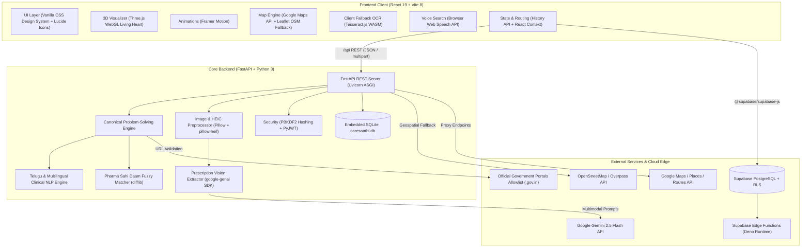

# CareSaathi AI — Complete Technical Architecture & Technology Stack

**Project:** CareSaathi AI — Healthcare Cost, Care & Scheme Navigator for India  
**Date of Audit:** October 11, 2026  
**Version:** 1.0.0  

---

## 1. System Architecture Diagram



---

## 2. Frontend Technologies & Dependencies Breakdown

### 2.1 Core Framework, Build Tools & Runtime
| Technology | Version | Status | Purpose & Why It Is Used | Exact Location in Repository |
| :--- | :--- | :--- | :--- | :--- |
| **React** | `^19.2.8` | **Actively Used** | Foundation component library for declarative UI rendering, hooks, and reconciliation. | [`frontend/package.json`](file:///c:/Users/Durgamanisai/CareSaathi-AI/frontend/package.json#L23), imported across all `.tsx` files |
| **React DOM** | `^19.2.8` | **Actively Used** | Renders React elements into the DOM tree at `index.html` root. | [`frontend/package.json`](file:///c:/Users/Durgamanisai/CareSaathi-AI/frontend/package.json#L24), [`frontend/src/main.tsx`](file:///c:/Users/Durgamanisai/CareSaathi-AI/frontend/src/main.tsx#L2) |
| **Vite** | `^8.3.0` (`8.3.4`) | **Actively Used** | Next-generation build tool powered by Rolldown. Handles lightning-fast HMR during development and outputs optimized production bundles to `dist/`. Configures `/api` reverse proxy. | [`frontend/package.json`](file:///c:/Users/Durgamanisai/CareSaathi-AI/frontend/package.json#L37), [`frontend/vite.config.ts`](file:///c:/Users/Durgamanisai/CareSaathi-AI/frontend/vite.config.ts) |
| **TypeScript** | `~6.0.2` | **Actively Used** | Static typing, interface definitions for DTOs, and compiler safety (`tsc -b`). | [`frontend/tsconfig.json`](file:///c:/Users/Durgamanisai/CareSaathi-AI/frontend/tsconfig.json), [`frontend/tsconfig.app.json`](file:///c:/Users/Durgamanisai/CareSaathi-AI/frontend/tsconfig.app.json) |
| **@vitejs/plugin-react** | `^6.1.1` | **Actively Used** | Official Vite plugin for React fast refresh and JSX transformation. | [`frontend/vite.config.ts`](file:///c:/Users/Durgamanisai/CareSaathi-AI/frontend/vite.config.ts#L2) |
| **Oxlint** | `^1.81.0` | **Actively Used** | High-performance Rust-based linter used for code quality auditing. | [`frontend/package.json`](file:///c:/Users/Durgamanisai/CareSaathi-AI/frontend/package.json#L9), [`frontend/.oxlintrc.json`](file:///c:/Users/Durgamanisai/CareSaathi-AI/frontend/.oxlintrc.json) |

---

### 2.2 UI, Styling, Visuals & 3D Graphics
| Technology | Version | Status | Purpose & Why It Is Used | Exact Location in Repository |
| :--- | :--- | :--- | :--- | :--- |
| **Vanilla CSS Design System** | Native CSS3 | **Actively Used** | Tailored CSS design system using CSS Custom Properties (tokens), frosted glassmorphism (`backdrop-filter`), responsive cards, and layout grids. Zero reliance on TailwindCSS or UI component frameworks. | [`frontend/src/index.css`](file:///c:/Users/Durgamanisai/CareSaathi-AI/frontend/src/index.css), [`frontend/src/App.css`](file:///c:/Users/Durgamanisai/CareSaathi-AI/frontend/src/App.css), [`CostEstimatorPage.css`](file:///c:/Users/Durgamanisai/CareSaathi-AI/frontend/src/pages/CostEstimatorPage.css) |
| **Lucide React** | `^1.54.0` | **Actively Used** | Clean, accessible SVG vector icon system across menus, trust badges, emergency banners, and buttons. | 40+ components, e.g. [`Navbar.tsx`](file:///c:/Users/Durgamanisai/CareSaathi-AI/frontend/src/components/Navbar.tsx#L21), [`Sidebar.tsx`](file:///c:/Users/Durgamanisai/CareSaathi-AI/frontend/src/components/Sidebar.tsx#L22) |
| **Framer Motion** | `^14.0.0` | **Actively Used** | Physics-based spring animations, tab transitions, sliding drawers, donut chart reveals, and staggered card entrances. | [`CareCoreHero.tsx`](file:///c:/Users/Durgamanisai/CareSaathi-AI/frontend/src/components/CareCoreHero.tsx#L14), [`CostEstimatorPage.tsx`](file:///c:/Users/Durgamanisai/CareSaathi-AI/frontend/src/pages/CostEstimatorPage.tsx#L24) |
| **Three.js** | `^0.186.1` | **Actively Used** | WebGL 3D rendering for the interactive anatomical "Living Heart", featuring custom extruded geometries, dynamic multi-point directional lighting, additive blended shockwaves, and mouse parallax. | [`CareCore3D.tsx`](file:///c:/Users/Durgamanisai/CareSaathi-AI/frontend/src/components/CareCore3D.tsx#L9), [`LivingHeart3D.tsx`](file:///c:/Users/Durgamanisai/CareSaathi-AI/frontend/src/components/LivingHeart3D.tsx#L12) |

---

### 2.3 Maps, Client OCR & Integration Libraries
| Technology | Version | Status | Purpose & Why It Is Used | Exact Location in Repository |
| :--- | :--- | :--- | :--- | :--- |
| **@googlemaps/js-api-loader** | `^2.1.3` | **Actively Used** | Asynchronously injects and loads Google Maps JavaScript SDK modules (`maps`, `marker`) on demand. | [`GoogleMapProvider.tsx`](file:///c:/Users/Durgamanisai/CareSaathi-AI/frontend/src/components/maps/GoogleMapProvider.tsx#L2) |
| **@googlemaps/markerclusterer**| `^2.6.2` | **Actively Used** | Groups high-density hospital pins together into interactive clusters when zoomed out. | [`GoogleMapProvider.tsx`](file:///c:/Users/Durgamanisai/CareSaathi-AI/frontend/src/components/maps/GoogleMapProvider.tsx#L3) |
| **Leaflet** | `^1.9.4` | **Actively Used** | Open-source mapping engine using OpenStreetMap tiles. Acts as a zero-cost fallback when Google Maps API key is not configured. | [`LeafletMapProvider.tsx`](file:///c:/Users/Durgamanisai/CareSaathi-AI/frontend/src/components/maps/LeafletMapProvider.tsx#L2), [`HospitalMap.tsx`](file:///c:/Users/Durgamanisai/CareSaathi-AI/frontend/src/components/HospitalMap.tsx#L2) |
| **Tesseract.js** | `^7.0.0` | **Actively Used (Dynamic Fallback)** | Client-side WebAssembly OCR engine that runs offline in the browser to extract text from prescription images when backend AI is unreachable. | [`MedicineCostEstimator.tsx`](file:///c:/Users/Durgamanisai/CareSaathi-AI/frontend/src/components/MedicineCostEstimator.tsx#L315), trained data at [`eng.traineddata`](file:///c:/Users/Durgamanisai/CareSaathi-AI/frontend/eng.traineddata) |
| **@supabase/supabase-js** | `^2.117.3` | **Actively Used** | Client library for Supabase PostgreSQL database interaction, user auth state, and slot reservation. | [`frontend/src/services/supabase.ts`](file:///c:/Users/Durgamanisai/CareSaathi-AI/frontend/src/services/supabase.ts#L6), [`appointmentRepository.ts`](file:///c:/Users/Durgamanisai/CareSaathi-AI/frontend/src/services/appointmentRepository.ts#L6) |
| **Web Speech API** | Native Browser | **Actively Used** | Native browser speech recognition (`webkitSpeechRecognition`) and speech synthesis (`speechSynthesis`) for voice search. | [`VoiceSearchModal.tsx`](file:///c:/Users/Durgamanisai/CareSaathi-AI/frontend/src/components/VoiceSearchModal.tsx#L85) |
| **Fuse.js** | `^7.5.0` | **Declared But Unused** | Listed in `package.json`, but never imported in `frontend/src/`. Medicine search is executed via backend Levenshtein matching or native string filtering. | [`frontend/package.json`](file:///c:/Users/Durgamanisai/CareSaathi-AI/frontend/package.json#L20) |

---

### 2.4 Frontend Routing & State Management
- **Zero-Dependency SPA Router:** Implemented using standard HTML5 History API (`window.history.pushState`, `replaceState`, and `popstate` listeners) in [`frontend/src/App.tsx`](file:///c:/Users/Durgamanisai/CareSaathi-AI/frontend/src/App.tsx#L80-L100). No `react-router-dom` is required.
- **Global State Contexts:**
  - `AuthContext`: Token storage, session expiration, judge demo account fallback, and Supabase auth synchronization.
  - `SearchContext`: Current patient journey state (selected procedure, city, state, pin code, and comparison tray).
  - `LanguageContext`: Internationalization switcher across English (`en`), Telugu (`te`), and Hindi (`hi`).

---

## 3. Backend Technologies & Dependencies Breakdown

### 3.1 Language, Web Framework & Core Runtime
| Technology | Version / Spec | Status | Purpose & Why It Is Used | Exact Location in Repository |
| :--- | :--- | :--- | :--- | :--- |
| **Python** | `3.10+` | **Actively Used** | Primary backend language for web services, algorithms, and clinical NLP. | [`backend/app`](file:///c:/Users/Durgamanisai/CareSaathi-AI/backend/app) |
| **FastAPI** | `>=0.110.0` | **Actively Used** | High-performance ASGI framework for RESTful routing, dependency injection, and automatic OpenAPI schema generation. | [`backend/app/main.py`](file:///c:/Users/Durgamanisai/CareSaathi-AI/backend/app/main.py#L52) |
| **Uvicorn** | `>=0.28.0` | **Actively Used** | Production ASGI server running the FastAPI app. | [`run.bat`](file:///c:/Users/Durgamanisai/CareSaathi-AI/run.bat#L8) |
| **Pydantic** | `>=2.6.0` | **Actively Used** | Strict data validation, schema enforcement, and JSON serialization for request/response models. | [`schemas.py`](file:///c:/Users/Durgamanisai/CareSaathi-AI/backend/app/models/schemas.py) |
| **python-multipart** | `>=0.0.9` | **Actively Used** | Enables FastAPI to accept `multipart/form-data` uploads (e.g. camera photo uploads of prescriptions). | [`main.py`](file:///c:/Users/Durgamanisai/CareSaathi-AI/backend/app/main.py#L4), [`requirements.txt`](file:///c:/Users/Durgamanisai/CareSaathi-AI/backend/requirements.txt#L4) |
| **Requests & HTTPX** | `>=2.31.0` / `>=0.27.0` | **Actively Used** | Outbound HTTP clients querying external services (Overpass OpenStreetMap, Nominatim, Google Proxies). | [`requirements.txt`](file:///c:/Users/Durgamanisai/CareSaathi-AI/backend/requirements.txt#L5-L6) |
| **python-dotenv** | — | **Actively Used** | Reads `.env` configuration file into `os.environ`. | [`backend/app/config.py`](file:///c:/Users/Durgamanisai/CareSaathi-AI/backend/app/config.py#L5-L12) |
| **NumPy, Pandas, OpenCV**| — | **ABSENT (Not Used)** | Not imported or required anywhere in the codebase. All matrix, Haversine, and data transformations use standard library `math` and `sqlite3`. | 0 imports in repository |

---

### 3.2 Image Processing & Document Conversion
| Technology | Category | Status | Purpose & Why It Is Used | Exact Location in Repository |
| :--- | :--- | :--- | :--- | :--- |
| **Pillow (PIL)** | Image Processing | **Actively Used** | Preprocesses uploaded images: EXIF auto-rotation (`exif_transpose`), 2000px Lanczos resizing, grayscale conversion, and contrast enhancement. | [`image_preprocessor.py`](file:///c:/Users/Durgamanisai/CareSaathi-AI/backend/app/services/image_preprocessor.py#L5) |
| **pillow-heif** | HEIC/HEIF Codec | **Actively Used** | Registers an opener enabling Pillow to natively decode Apple iPhone HEIC prescription images. | [`image_preprocessor.py`](file:///c:/Users/Durgamanisai/CareSaathi-AI/backend/app/services/image_preprocessor.py#L6-L9) |
| **PyMuPDF / fitz** | PDF Parser | **Optional Fallback** | Optional dependency loaded via `try...except ImportError` to render PDF prescription pages into image matrices before OCR. | [`image_preprocessor.py`](file:///c:/Users/Durgamanisai/CareSaathi-AI/backend/app/services/image_preprocessor.py#L11-L17) |

---

### 3.3 Clinical AI, Multilingual NLP & Fuzzy Matching
| Technology | Category | Status | Purpose & Why It Is Used | Exact Location in Repository |
| :--- | :--- | :--- | :--- | :--- |
| **google-genai** (SDK) | Multimodal Vision AI | **Actively Used** | Interacts with Google Gemini 2.5 Flash to extract medicine names, dosages, frequencies (`1-0-1`, `OD`, `TDS`), and doctor notes from doctor prescriptions. | [`vision_extractor.py`](file:///c:/Users/Durgamanisai/CareSaathi-AI/backend/app/services/vision_extractor.py#L6-L8) |
| **difflib.SequenceMatcher** | Fuzzy Matcher | **Actively Used** | Calculates Levenshtein similarity ratios between OCR drug strings and the Jan Aushadhi (PMBJP) generic pharmaceuticals registry. | [`fuzzy_medicine_matcher.py`](file:///c:/Users/Durgamanisai/CareSaathi-AI/backend/app/services/fuzzy_medicine_matcher.py#L2) |
| **Telugu Clinical NLP Engine**| Linguistic Parser | **Actively Used** | Specialized rule-based engine performing Unicode normalization, Telugu numeral mapping (`౦-౯`), emergency detection, and Telugu-English code-switching parsing. | [`telugu_nlp_engine.py`](file:///c:/Users/Durgamanisai/CareSaathi-AI/backend/app/services/telugu_nlp_engine.py) |
| **Statutory Allowlist Engine** | Safety Filter | **Actively Used** | Strictly enforces that all scheme links resolve to verified government domains (`.gov.in`, `.nic.in`) to prevent AI link hallucination. | [`backend/app/config.py`](file:///c:/Users/Durgamanisai/CareSaathi-AI/backend/app/config.py#L30-L115) |

---

### 3.4 Authentication & Security
| Technology | Implementation | Details |
| :--- | :--- | :--- |
| **PyJWT** (`>=2.8.0`) | JWT Token Generation & Verification | Generates signed cryptographic Bearer tokens for session persistence. Located at [`auth_service.py`](file:///c:/Users/Durgamanisai/CareSaathi-AI/backend/app/services/auth_service.py). |
| **Python hashlib** | Password Security | Uses PBKDF2-HMAC-SHA256 with 100,000 iterations and 16-byte random salts (`secrets.token_hex(16)`). Never stores plaintext passwords. |
| **Demo Guest Mode** | Zero-Config Evaluation | Provides instant pre-configured login for judges (`judge.demo@caresaathi.in`) and guest browsing. |

---

### 3.5 Database & Data Architecture
| Database | Engine | Tables / Schemas | Role in Platform |
| :--- | :--- | :--- | :--- |
| **Primary Local DB** | **SQLite** (`caresaathi.db`) | 1. `treatments`<br>2. `facilities`<br>3. `schemes`<br>4. `cost_observations`<br>5. `user_preferences`<br>6. `users`<br>7. `saved_comparisons` | Zero-configuration local relational database. Stores canonical surgery catalogue, empanelled hospitals, price benchmarks, and user data. Managed in [`database.py`](file:///c:/Users/Durgamanisai/CareSaathi-AI/backend/app/data/database.py). |
| **Cloud Database (Optional)** | **Supabase PostgreSQL** | 1. `public.hospital_slots`<br>2. `public.appointments` | Hosted PostgreSQL with Row Level Security (RLS) for real-time hospital appointments. Defined in [`20261009_appointments_and_slots.sql`](file:///c:/Users/Durgamanisai/CareSaathi-AI/supabase/migrations/20261009_appointments_and_slots.sql). |

---

## 4. Cloud Services & Supabase Edge Functions (Deno Runtime)

Located in [`supabase/functions/`](file:///c:/Users/Durgamanisai/CareSaathi-AI/supabase/functions):
1. **`geocode/`**: Edge proxy for Google Geocoding and Nominatim reverse geocoding.
2. **`places-nearby/`**: Edge proxy for Google Places Nearby hospital discovery without exposing backend keys.
3. **`place-details/`**: Fetches verified hospital phone numbers, opening hours, and ratings.
4. **`place-photo/`**: Streams hospital photo media directly to the frontend.
5. **`route-matrix/`**: Computes driving distance and transit duration via Google Routes API.
6. **`send-appointment-reminder/`**: Automated appointment reminder notification dispatcher.

---

## 5. Summary of Dependencies Classification

```
┌────────────────────────────────────────────────────────────────────────┐
│                        DEPENDENCY AUDIT RESULTS                        │
├────────────────────────────────────────────────────────────────────────┤
│  ACTIVELY USED:                                                        │
│  - Frontend: React 19, Vite, Three.js, Framer Motion, Leaflet,         │
│              Lucide React, Google Maps JS API Loader, MarkerClusterer, │
│              Supabase JS, Tesseract.js (fallback).                     │
│  - Backend:  Python 3, FastAPI, Uvicorn, Pydantic, python-multipart,   │
│              requests, httpx, PyJWT, google-genai, python-dotenv,      │
│              Pillow, pillow-heif, SQLite3 (standard library).          │
├────────────────────────────────────────────────────────────────────────┤
│  DECLARED BUT UNUSED:                                                  │
│  - Frontend: fuse.js (v7.5.0 in package.json, 0 imports in code).      │
├────────────────────────────────────────────────────────────────────────┤
│  UNLISTED OPTIONAL:                                                    │
│  - Backend:  PyMuPDF / fitz (optional PDF rasterizer in preprocessor).  │
├────────────────────────────────────────────────────────────────────────┤
│  ABSENT / NOT USED (Listed as examples in prompts only):               │
│  - NumPy, Pandas, OpenCV (cv2), Scikit-Learn, PyTorch, TensorFlow.     │
│    (Zero imports across the entire repository).                        │
└────────────────────────────────────────────────────────────────────────┘
```
